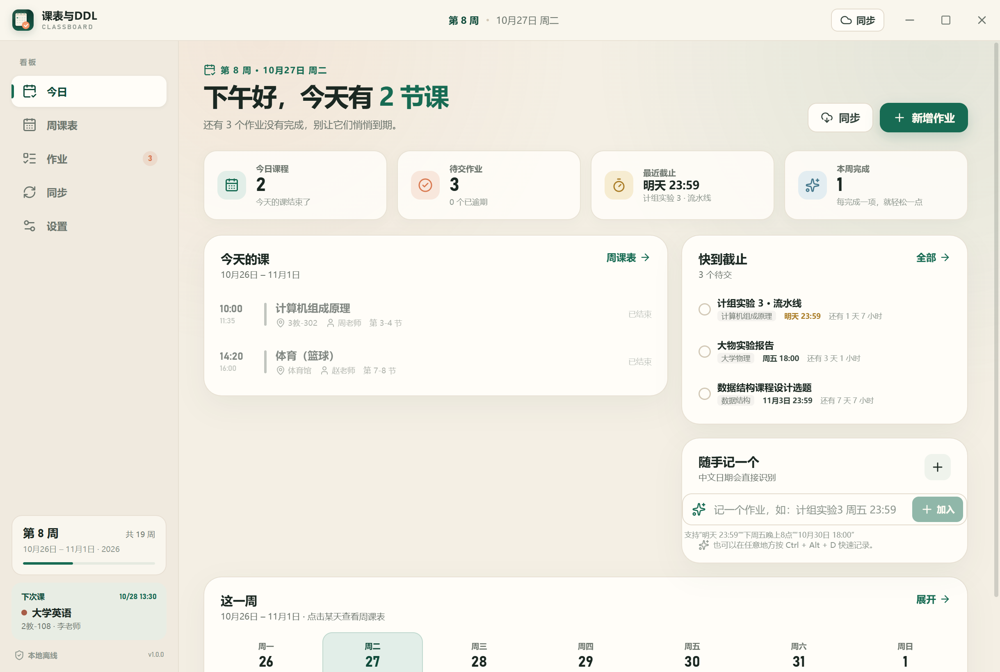
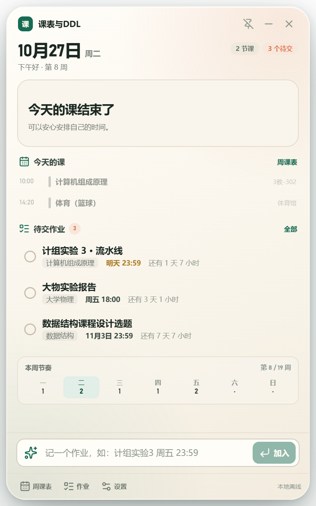

# 课表与DDL看板（ClassBoard）

一个本地优先的 Windows 学习看板：开机后在桌面右下角显示今天要上什么课、哪些作业快截止，并在 DDL 之前用 Windows 通知提醒你。

所有课表、作业和提醒都保存在本机；只有你主动点击同步时才会访问教务或学习平台，不经过任何第三方服务器，也不保存账号密码。

## 功能

- **桌面小部件**：今日课程时间线、下一节/正在上的课、待交作业、中文快速添加；可拖动、置顶、隐藏到托盘，位置会被记住。
- **完整窗口**：今日概览、周课表网格、作业清单、同步中心、设置。
- **周课表**：周一至周日 × 12 节课，支持单双周与不连续周次，点击空白格添加课程，点击课程编辑。
- **DDL 管理**：新增、编辑、完成、删除、搜索、分组；支持中文快速添加（`计组实验3 周五23:59`、`下周三晚上8点`、`10月30日 18:00`）。
- **提醒**：默认提前 1 天 / 6 小时 / 1 小时通知，可增减节点；支持稍后提醒；睡眠唤醒、开机启动后会补发最近的提醒。
- **杭电课表同步**：内置数字杭电登录窗口，登录后自动寻找「教务系统」入口，进入「信息查询 → 个人课表查询」即可读取；兼容旧版 / 新版课表结构，也支持导入已保存的课表 HTML。
- **学习通作业同步**：登录杭电泛雅后直接读取作业列表（标题 / 状态 / 课程 / 剩余时间），先预览再写入。
- **PTA 作业同步**：内置 PTA 登录，通过题目集接口读取所有未截止题目集及其截止时间；按整个题目集生成一条 DDL。
- **雨课堂作业同步**：内置登录窗口 + 页面扫描（实验性），结果可逐条核对修改。
- **离线兜底**：JSON 完整备份 / 恢复、作业 CSV 导入导出、手动录入；同步失败不会影响已有数据。
- **本地优先**：无云同步、无遥测；数据文件与自动备份都在本机。

## 安装与首次使用



1. 运行安装包 `ClassBoard-1.0.0-Setup.exe`（未签名，SmartScreen 提示时选择「更多信息 → 仍要运行」）。
2. 安装位置默认是 `%LOCALAPPDATA%\Programs\ClassBoard`，会创建开始菜单和桌面快捷方式；卸载可在 Windows「设置 → 应用」中完成，卸载时会一并移除开机自启项。
3. 首次启动填写「第 1 周周一」和学期总周数，建议保持「开机自动启动」开启。
4. 选择一种方式开始：
   - **同步杭电课表**：在应用内打开杭电统一认证，登录后点窗口顶部的「读取课表」，确认识别结果后写入看板。
   - **先进入看板**：稍后再同步；也可以在周课表里手动添加课程。
   - **先看看示例数据**：载入一份示例课表和作业体验界面。

桌面小部件：



排查问题时可以查看日志：`%APPDATA%\ClassBoard\classboard.log`。

## 同步说明

### 杭电教务

- 应用内打开「数字杭电」官方登录页，由你本人完成登录；应用不保存账号密码。
- 现行路径：**数字杭电 → 教务系统 → 信息查询 → 个人课表查询**。登录后应用会自动寻找「教务系统」入口；进入新版教务后点窗口顶部的「读取课表」。
- 新版正方教务使用 `xskbcx_cxXsgrkb` 接口读取课程，每门课的周次取自 `zcd` 字段（例如 `1-16周`、`1-8周(单)`），不会再被页面上的 1-30 周选择器干扰。
- 旧域名 `jxgl.hdu.edu.cn` 已不再对外解析，不要再直接访问它。校外访问教务系统通常需要校园网或学校 VPN。
- 如果内置窗口一直空白，或读取后没有识别到课程：
  1. 在 Edge/Chrome 里按上面的路径打开个人课表查询；
  2. 按 `Ctrl+S` 保存网页为 `.html`；
  3. 回到应用的同步页选择「导入 HTML」，确认识别结果后写入。
  4. 如果新页面结构仍无法识别，请把保存的 HTML（可删去姓名、学号）反馈给开发者适配。
- 预览页提供「合并」（更新同名杭电课程）和「替换」（移除本次未出现的旧杭电课程）两种写入方式；写入前会自动备份。

### 学习通

- 杭电的网页端是**泛雅平台**：`https://hdu.fanya.chaoxing.com/portal`（机构 fid=1001）。应用内登录后点窗口顶部的「读取作业」，会读取作业列表（未提交 / 剩余时间等）。
- 不要使用 `i.mooc.hdu.edu.cn` 子域：该路径会返回 404；`i.mooc.chaoxing.com/space/index` 是超星通用空间，不是杭电机构入口。
- 若接口读取为空，会自动尝试扫描你当前打开的作业页面；也可以手动打开具体课程的「作业」列表后再读一次。
- 结果先进入预览，标题、课程、截止时间都可以修改，确认后才写入。

### PTA

- 登录 `https://pintia.cn/` 后点窗口顶部的「读取题目集」，应用会通过 `GET /api/problem-sets?filter={"endAtAfter":...}` 读取所有未截止题目集。
- 每个题目集的 `endAt` 会生成一条 DDL，课程名取开课单位（若只是学校名则留空），来源链接指向对应题目集。
- 题目集内的小题不会单独生成提醒；PTA 列表接口也不提供完整的逐题完成状态，请在应用里手动勾选完成。
- 如果接口因登录态或风控失败，会尝试扫描你当前打开的题目集页面；结果仍需逐条核对。

### 雨课堂

- 登录后进入具体课程的「作业 / 待办」列表，等页面加载完成，再点窗口顶部的「扫描当前页」。
- 页面扫描属于实验性功能：依赖页面结构，识别结果必须逐条核对；没有识别到截止时间的条目可以手动补充。

## 提醒与后台运行

- 提醒由应用主进程在本机调度，应用需要在运行（托盘或小部件）状态才能发出通知。
- 关闭主窗口默认隐藏到托盘；如果想关闭即退出，可在「设置 → 启动与窗口」中关闭「关闭窗口时隐藏到托盘」，但这样提醒也会停止。
- 若收不到通知，检查 Windows「专注助手 / 勿扰模式」，或在设置里点「发送测试通知」。
- 课堂提醒默认关闭，可在「设置 → 提醒」中开启（默认提前 10 分钟）。

## 数据、备份与隐私

- 数据目录：`%APPDATA%\ClassBoard`（开发模式为 `%APPDATA%\ClassBoardDev`）。
- `data.json` 保存课表、作业和设置；`backups` 保存自动备份（写入同步、恢复、清空、载入示例前都会备份）。
- 登录状态只保存在 Chromium 的加密 Cookie 中，可用各平台的「清除登录」一键清除；应用不保存账号密码。
- 完整备份是 JSON，作业表格是 CSV（含 BOM，Excel 可直接打开）。
- 应用不发送任何遥测数据，不同步到云端。

## 开发

技术栈：Electron + React + TypeScript + Vite（`electron-vite`），打包使用 `electron-builder`。

```bash
npm install

# 开发（热更新）
npm run dev

# 单元测试
npm test

# 类型检查
npm run typecheck

# 构建安装包（输出到 release/）
npm run dist
```

如果本机环境带有 `ELECTRON_RUN_AS_NODE=1`（某些自动化环境会注入），开发时需要临时去掉：

```bash
env -u ELECTRON_RUN_AS_NODE npm run dev
```

目录结构：

```
src/main         Electron 主进程：窗口、托盘、提醒调度、本地存储、同步
src/preload      contextBridge 桥接层
src/renderer     React 界面：小部件、今日、周课表、作业、同步、设置、首次引导
src/shared       共享类型、日期/课表计算、中文日期解析、杭电/学习通解析
scripts          图标生成、视觉验收、端到端检查等开发脚本
```

## 已知限制

- 课程周次、调休和节假日目前按「第 1 周周一 + 总周数」推算，不自动处理调休；可以在周课表中手动调整课程周次。
- 杭电课表解析依赖正方教务页面的表格结构；如果学校改版，需要用「导入 HTML」保留页面并调整解析规则。
- 学习通接口和雨课堂页面扫描都可能随平台改版失效，届时可用手动录入或 CSV 导入。
- 安装包未做数字签名，首次运行可能出现 SmartScreen 提示。
- 应用不会在完全退出后提醒；请保持托盘运行。

## License

MIT